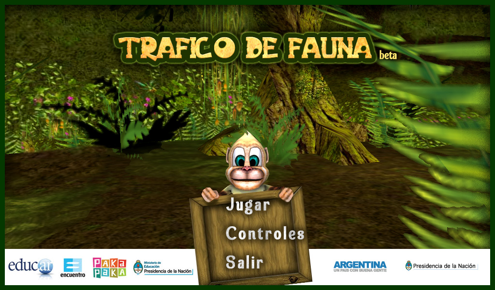

# 🐒 Tráfico de Fauna

3D stealth and rescue game set in the [Misiones rainforest](https://en.wikipedia.org/wiki/Alto_Paran%C3%A1_Atlantic_forests).
You control a [capuchin monkey](https://en.wikipedia.org/wiki/Black_capuchin) who must avoid the guards, collect
bananas and get the keys to free the animals trapped by wildlife traffickers.

Developed by **Educ.ar S.E.** in 2012 to get children aged 8 to 12 talking about illegal wildlife trafficking, and
recovered as an open source project. Learn about its history in the [introduction](docs/introduction.md).


[](LICENSE)
[](https://github.com/tgc-utn/tgc-viewer)



## Features

- Stealth: fixed and movable hiding spots to stay out of sight.
- Guards with patrols, field of view and chase.
- Bananas and breakable crates, colored keys and animal cells to unlock.
- Jump platforms between areas of the scene.
- One level, *Selva Misionera*, split into 6 sectors.
- Designed for the netbooks of the Conectar Igualdad program (fixed 1024x600 resolution).

## Controls

| Action                         | Key                |
| ------------------------------ | ------------------ |
| Move forward / backward        | `↑` / `↓`          |
| Turn                           | `←` / `→`          |
| Action                         | `Space`            |
| Crouch                         | Left `Alt`         |
| Change sector (on a connector) | `Space`            |
| Advance dialogs                | `Enter` or `Space` |
| Menu / pause                   | `Esc`              |

The movement, action, crouch and `Enter` keys can be changed in `Media\config.xml`, inside the game folder.

## Installation

Download the `TraficoFaunaInstaller-<version>.exe` installer from
[Releases](https://github.com/tgc-utn/trafico-de-fauna/releases), run it and follow the steps. It does not require
administrator rights, except to install DirectX if needed. It requires
[.NET Framework 4.8.1](https://dotnet.microsoft.com/download/dotnet-framework/net481).

## Building from source

The game is written in C#.

Requirements:

- Windows with Visual Studio (or MSBuild) and the .NET Framework 4.8.1 Developer Pack.
- Managed DirectX 1.1 and the DirectX 9 runtime (June 2010).

Steps:

1. Clone the repository.
2. Open `Trafico.De.Fauna.slnx` and restore the NuGet packages (includes `TGC.Core`).
3. Build and run in the `Debug` or `Release` configuration, **x86** platform.

To build the installer, see [installer/README.md](installer/README.md).

## Documentation

The technical documentation (architecture, levels, enemies, debug mode) is in the [`docs`](docs/introduction.md)
folder and is built with [Docsify](https://docsify.js.org/). To preview it locally, install
[docsify-cli](https://github.com/docsifyjs/docsify-cli) and serve the folder:

```
npm i docsify-cli -g
docsify serve docs
```

## Repository structure

| Path                    | Contents                                |
| ----------------------- | --------------------------------------- |
| `src\Trafico.De.Fauna\` | Game code and assets                    |
| `installer\`            | NSIS script and DirectX redistributable |
| `docs\`                 | Documentation (Docsify)                 |
| `CHANGELOG.md`          | Changelog by version                    |

## License

Copyright 2012 Educ.ar S.E.

Distributed under the [GNU GPL v3 or later](LICENSE) license.
