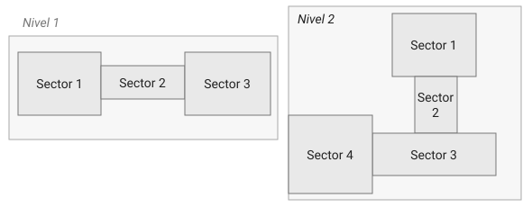
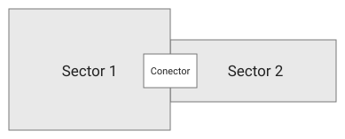
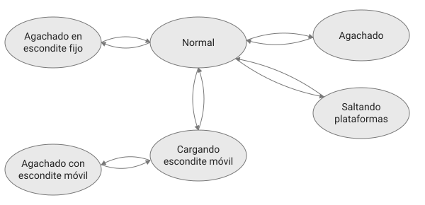
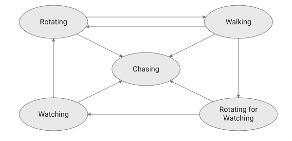
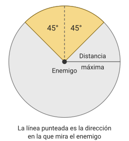

# Arquitectura

## Framework de renderizado 3D

El juego utiliza [TGC.Core](https://github.com/tgc-utn/tgc-viewer), el framework de la cátedra Técnicas de Gráficos
por Computadora (TGC) de la Universidad Tecnológica Nacional de Buenos Aires. Más información en el
[sitio de la materia](https://www.tgcutn.com.ar/).

El framework está orientado a la creación de Trabajos Prácticos en 3D por parte de los alumnos, por lo que no cubre
todo lo que necesita un juego completo. Lo que faltaba se desarrolló como parte del código fuente del juego.

## Principal

El punto de entrada de todo el juego es la clase “GameModel.cs”, ubicada dentro de la carpeta “src\Trafico.De.Fauna\Model”.
Esta clase controla todo el flujo del juego y posee referencias a las clases principales. Algunas de ellas son:

- MainCharacter: maneja toda la lógica del jugador
- GameConfig: parámetros de configuración de todo el juego
- Level: nivel actual del juego
- GuardiasPool: maneja los modelos 3D de los enemigos
- HUD: maneja todos los menús y efectos 2D del juego
- GameSounds: sonidos de todo el juego
- Shaders: efectos de shader utilizados en el juego

El juego fue diseñado para las netbooks del Programa Conectar Igualdad, por lo tanto posee una resolución fija de
pantalla de 1024x600, definida en la ventana “src\Trafico.De.Fauna\Form\GameForm.cs”.

## Configuración

El juego posee todos sus parámetros de configuración en el archivo XML ubicado en
“src\Trafico.De.Fauna\Media\config.xml”. Al iniciar el juego todos los parámetros son cargados y almacenados en
la clase “GameConfig.cs”. Diversas partes del juego acceden a estos parámetros para variar su comportamiento.

## Niveles

Los escenarios del juego se dividen en niveles. Cada nivel es autónomo y discreto. Si el jugador pasa del nivel 1 al
2, ya no puede volver al 1.

El nivel entero se carga en memoria. Cuando se pasa al siguiente nivel se limpia toda la memoria y se carga con los
datos del próximo nivel.

Un nivel se subdivide en varias regiones, denominadas Sectores. El jugador siempre se encuentra dentro de un sector.
Los sectores son discretos, o está en un sector o está en otro.

El jugador solo ve un sector a la vez. Los únicos modelos que se envían a dibujar a la placa de video son los del
sector actual. Todos los demás sectores son obviados.

Lo mismo ocurre para la detección de colisiones, inteligencia artificial de enemigos, sonidos, bananas, cajas, etc.
Todo transcurre siempre dentro del sector actual.

## Assets de niveles

Todos los assets de los niveles se ubican en la carpeta “src\Trafico.De.Fauna\Media\Levels”. Luego cada nivel debe
ser declarado en el archivo config.xml, dentro del tag “levels”. El orden de declaración en el XML es el orden de
los niveles dentro del juego.

El juego posee actualmente un solo nivel que se compone de 6 sectores. El nivel se llama “Level1-SelvaMisionera”.
Adentro posee la siguiente estructura:

- Sector-NOMBRE: una carpeta para cada sector del nivel. Hay 6 sectores:
  - Sector-Area1: sector “Inicio de la Selva”
  - Sector-Area2: sector “Valle del oeste”
  - Sector-Area3: sector “Valle de las Piedras”
  - Sector-Area4: sector “Precipicio de la Selva”
  - Sector-Area5: sector “Selva del Este”
  - Sector-Area6: sector “Selva de Bananas”
- SkyBox: texturas del SkyBox de todo el nivel

Cada carpeta de sector posee la geometría del escenario (archivo “Scene-TgcScene.xml”), una carpeta “Textures” con
sus texturas y una carpeta “LightMaps” con una textura de lightmap compartida por todos los modelos.

Todos los assets de modelos 3D (sectores, cajas, bananas, etc.) se encuentran en el formato de XML TGC del framework
mencionado anteriormente.

## Conectores

Un conector es un objeto del escenario que permite comunicar un sector con otro. Se ubican en un determinado lugar
del escenario y cuando el usuario colisiona con él y presiona la tecla de acción se pasa al siguiente sector.

De esta forma el usuario puede ir navegando de un sector a otro. La división discreta en sectores es útil para
optimizar el renderizado de modelos, dado que solo hay que ocuparse de los modelos del sector actual.

Los sectores son diseñados para que desde un sector nunca se llegue a ver hacia el otro.

## Objetos del escenario

Cada sector se compone por un conjunto de modelos 3D. Los modelos pueden ser básicamente de dos categorías:

- Modelos reales, es decir, que realmente se verán en pantalla.
- Objetos lógicos, que solo sirven para agregar algún tipo de información o meta-dato al escenario, pero que luego no
  se terminan viendo en el juego. Se crean como cajas 3D de las que se obtiene su posición y volumen (Bounding Box)
  dentro del escenario.

Los primeros son los modelos que conforman las paredes, pisos, árboles y otros objetos típicos del escenario. Los
segundos se utilizan para los objetos que tienen algún comportamiento especial. Esta división se hace utilizando el
concepto de “layer”. Cada modelo del escenario indica a qué layer pertenece, y cada layer determina un comportamiento
particular.

Los layers que pueden ser utilizados dentro de un sector son los siguientes:

- “Bananas”: objetos lógicos que indican la ubicación de una banana dentro del sector para ser agarrada por el
  personaje.
- “CajasBananas”: objetos lógicos que indican la ubicación de las cajas de bananas dentro del sector para ser rotas
  por el personaje.
- “ColisionesLogicas”: objetos lógicos que representan volúmenes de colisión pero que no se ven en el juego.
- “Conectores”: objetos lógicos que permiten cambiar de un sector a otro del nivel.
- “CustomEvents”: objetos lógicos que ejecutan una clase de C# con código específico, en la posición en la que se
  creó el objeto.
- “EsconditesFijos”: objetos lógicos que indican la posición de un escondite fijo para ser utilizado por el
  personaje.
- “EsconditesMoviles”: objetos lógicos que indican la posición de un escondite móvil para ser agarrado por el
  personaje.
- “Guardias”: objetos lógicos que indican los waypoints de patrulla de los distintos enemigos de un sector.
- “ItemsAnimal”: objetos lógicos que indican la ubicación de las celdas de animales a rescatar con llaves.
- “Llaves”: objetos lógicos que indican la ubicación de las 3 llaves de colores para abrir las celdas de animales.
- “Saltos”: objetos lógicos que indican la ubicación de las plataformas de saltos.
- “SinColision”: modelos reales del sector que no se quiere que participen en el proceso de detección de colisiones.
- “SinColision_NOMBRE”: variantes del layer “SinColision”, por ejemplo “SinColision_Arboles” o “SinColision_Suelos”.
  Se tratan igual que “SinColision”.
- “Sonido”: el juego lo reconoce pero no está implementado; los objetos de este layer se ignoran. Actualmente ningún
  sector lo utiliza.
- “WaypointsAtaque”: nodos de los waypoints globales de persecución de los enemigos, una funcionalidad que no se
  llegó a terminar (ver Enemigos). Actualmente ningún sector lo utiliza.
- Otros layers: cualquier otro modelo que se encuentre en un layer distinto de los especificados anteriormente se
  considera un modelo 3D visible dentro del juego y que participa en la detección de colisiones.

El mecanismo de layers permite crear el escenario con todos sus objetos de manera declarativa a nivel de diseño, sin
tener que programar cada interacción a medida.

Por ejemplo para agregar una Banana al escenario se crea una caja 3D bajo el layer “Bananas” y se ubica en una
determinada parte del escenario del sector. Particularmente para una Banana no interesa el tamaño de la caja ni su
forma, solo se utiliza el centro del Bounding Box de la caja para obtener la posición en la que se debe posicionar la
Banana. Luego el juego quita el modelo “caja” y lo reemplaza por un modelo 3D de la Banana.

Este mismo procedimiento se utiliza para la mayoría de los objetos.

A su vez algunos objetos soportan que se les indiquen ciertas propiedades, denominadas “User Properties”. Por ejemplo
a un objeto del layer “CajasBananas” se le debe especificar la propiedad “bananas” para indicar la cantidad de
bananas que otorga cuando el personaje rompe la caja.

Otros objetos utilizan algún juego de nomenclatura en el nombre del modelo. Por ejemplo los waypoints de patrulla de
los enemigos son de la forma `Guardia_NOMBRE_NUMERO`, donde NOMBRE es el nombre del guardia y NUMERO es el índice del
waypoint dentro de la patrulla (Ej: `Guardia_Principal_2`).

## Colisiones del escenario

Los modelos 3D simples de un escenario (aquellos que no poseen ningún comportamiento especial) se pueden dividir en
dos categorías:

- Solo decorativos (layer “SinColision”)
- Influyen en la detección de colisiones (modelos en otros layers no especificados)

Los primeros pueden ser atravesados por el personaje principal. No son considerados para colisión. Se utilizan
principalmente para la vegetación de los escenarios.

También existe una categoría de objetos colisionables virtuales. Es decir, objetos que participan en la detección
de colisiones pero que no se ven en pantalla. Se utilizan para delimitar regiones de los escenarios. Son los que
pertenecen al layer “ColisionesLogicas”.

El personaje principal es modelado con un Bounding Sphere. El resto de los objetos son simplificados con un Bounding
Box. Se utilizan algoritmos de colisión dinámicos para una esfera en movimiento contra un Bounding Box (“moving
Sphere against Bounding Box”).

El manejo de colisiones del personaje principal se encuentra en la clase
“src\Trafico.De.Fauna\Model\MainCharacters\SphereCollisionManager.cs”.

La detección de colisiones contempla el efecto Sliding pero la gravedad se encuentra desactivada. El personaje y
todos los objetos transitables del escenario se encuentran siempre a nivel del piso.

El manejador de colisiones soporta gravedad: después de cada movimiento aplica una fuerza hacia abajo, cuyo valor se
toma del tag “gravedad” de “config.xml”. El personaje la desactiva al crearse, por lo que ese valor hoy no tiene
efecto.

## Bananas

Las bananas pueden ser dispuestas por todo el escenario bajo el layer “Bananas”. Poseen un Bounding Sphere. Cuando el
personaje choca contra este se agarra la banana.  
Las cajas de bananas pueden brindar una cantidad variable de bananas al romperse.  
Si no brinda ninguna se utiliza el modelo de caja sin textura de banana.  
El juego crea al inicio un pool de 50 modelos de banana y 40 modelos de cajas para ser luego reutilizados en cada
sector.

## Personaje principal

La lógica del mono capuchino es manejada por la clase “src\Trafico.De.Fauna\Model\MainCharacters\MainCharacter.cs”.

El personaje posee una malla con animación esquelética. Los assets del personaje se encuentran en
“src\Trafico.De.Fauna\Media\MainCharacterMono”:

- Mono-TgcSkeletalMesh.xml: modelo del mono en su postura inicial
- CrouchLeft-TgcSkeletalAnim.xml: animación de estar agachado y girar hacia la izquierda.
- CrouchRight-TgcSkeletalAnim.xml: animación de estar agachado y girar hacia la derecha.
- Crouch-TgcSkeletalAnim.xml: animación de estar agachado en el lugar.
- Jumping-TgcSkeletalAnim.xml: animación de saltar.
- Punch-TgcSkeletalAnim.xml: animación de golpear cajas.
- Run-TgcSkeletalAnim.xml: animación de correr.
- StandByCarryingObject-TgcSkeletalAnim.xml: animación de estar parado cargando un objeto con los brazos.
- StandBy-TgcSkeletalAnim.xml: animación de estar quieto.
- WalkCarryingObject-TgcSkeletalAnim.xml: animación de caminar cargando un objeto con los brazos.

El personaje se maneja por una máquina de estados que determina las acciones posibles que se pueden realizar en cada
momento.

Según el estado en el que se encuentra el personaje solo se permiten determinados inputs de teclado para hacer
acciones. Por ejemplo mientras está saltando no se puede agachar.

También se activan sonidos y se van cargando las animaciones acordes a cada estado.

## Enemigos

La lógica de los enemigos es manejada por las siguientes clases dentro de la carpeta “src\Trafico.De.Fauna\Model\Enemies\”:

- GuardiasPool.cs: pool de modelos 3D de enemigos para reutilizar entre los distintos sectores.
- GuardiasManager.cs: maneja todos los guardias de un sector.
- Guardia.cs: lógica de un guardia particular.
- GuardiaWaypoint.cs: waypoint de patrulla del guardia.

Los enemigos patrullan una zona y reaccionan al ver al personaje dentro de su cono de visión. Se manejan con una
máquina de estado, con las siguientes transiciones:

La zona a patrullar se define con waypoints. Los waypoints se determinan con números: 0, 1, 2, etc. La patrulla
siempre es circular, desde el último waypoint parte hacia el primero.
Al llegar a cada waypoint el enemigo puede:

- Encarar hacia el próximo
- O primero vigilar en el lugar y luego ir hacia el próximo

El cono de visión consiste en un Bounding Sphere centrado en el enemigo, restringido a un ángulo de 45 grados hacia
cada lado de la dirección en la que mira (90 grados en total). El radio de la esfera es la distancia máxima de visión.
Ambos valores se definen en “config.xml”, en los tags “anguloVision” y “distanciaVisual”.

Para que el enemigo vea al personaje, además no debe interponerse entre ambos ningún objeto colisionable del
escenario. Esa línea de visión se traza a menor altura cuando el personaje está agachado.

El enemigo también detecta al personaje si lo tiene muy cerca, aunque esté de espaldas (tag
“distanciaVisualEspaldas”). Un personaje escondido solo puede ser detectado de esta forma.

Cuando el enemigo ve al personaje sale a perseguirlo. Para esto se utiliza una estrategia de IA de "chase". En cada
cuadro el enemigo se orienta hacia la posición del personaje y avanza.  
Una limitación actual de los enemigos es que no poseen ningún tipo de detección de colisiones. Al patrullar
simplemente siguen los waypoints. Normalmente esto no es molestia porque los waypoints se disponen correctamente en
el escenario.  
Al perseguir al personaje tampoco detectan colisiones, simplemente rotan y avanzan hacia la posición del personaje. De
todas formas en general no es notorio. Dado que avanzan rápido y que el personaje sí tiene detección de colisiones,
normalmente el enemigo no pasa por zonas que no debería.  
Para mejorar este aspecto se comenzó a desarrollar una estrategia de waypoints globales por sector. Si por algún
motivo el enemigo se pierde o choca en la persecución, retorna al waypoint global más cercano. Y de ahí busca una ruta
hacia su waypoint de patrulla más cercano.  
Por motivos de tiempo del proyecto no se llegó a terminar esta implementación.

## Saltos

Por razones de tiempo y simplificación del proyecto, la detección de colisiones no tiene gravedad. Sin embargo el
personaje puede saltar.

Para ello se utilizan plataformas de saltos. Una plataforma de salto se compone de dos objetos lógicos:

- Plataforma 1
- Plataforma 2

Si el personaje se encuentra dentro del volumen de alguna de las plataformas puede saltar hacia la otra plataforma (y
viceversa). El juego calcula la distancia entre la plataforma de origen y la de destino y desplaza cuadro a cuadro al
personaje hacia el centro de la plataforma destino. El desplazamiento simula una parábola: sube en línea recta hasta una altura igual a la cuarta parte de la distancia y luego baja.

El salto es controlado automáticamente por el juego. El usuario no se puede mover mientras está saltando.

Las plataformas de salto siempre se especifican de a pares y son objetos lógicos del escenario que se ubican bajo el
layer “Saltos”.

Este mecanismo de salto está lejos de ser ideal, pero permitió agregar un nuevo ítem de jugabilidad con muy poco
tiempo y esfuerzo.

## Modo debug

El juego posee ciertos accesos (o trucos) especiales que ayudan a probar las distintas partes. Para activar el “modo
debug” se debe ir al archivo de configuración “config.xml” y cambiar el valor del tag “boundingSphereDebug” a 1
(0 es desactivado). Mientras está activo se muestran los cuadros por segundo y los ejes de coordenadas.

Al compilar el juego en configuración Debug también se puede activar y desactivar durante el juego con la tecla D.
El ejecutable de Release, que es el que distribuye el instalador, no incluye esa tecla.

El modo debug es manejado por la clase “src\Trafico.De.Fauna\Model\DebugTools\DebugMode.cs”.

Mientras está activo se pueden utilizar los siguientes controles:

- B: visualizar Bounding Volumes de todos los modelos y personajes.
- V: ganar una vida
- K: obtener todas las llaves
- I: otorgar una celda liberada
- G: desactivar a los enemigos (quedan congelados)
- S: muestra una lista de conectores de todos los sectores a los que se puede ir directamente.
- Número: transportarse directamente al conector indicado. El número sale de la lista que se muestra con “S”. Si el
  número es mayor a 9, mantener Alt presionado y presionar su último dígito.
- M: muestra una ventana con el uso de memoria de las texturas cargadas.
