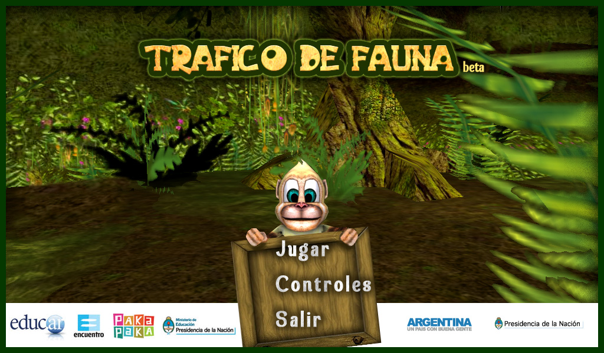

# Introducción

Este sitio se generó a partir de la
[documentación original](original-documentation.pdf ':ignore') de 2012 y
brinda información sobre las decisiones de diseño y las cuestiones técnicas que se tuvieron en cuenta a la hora de
desarrollar el videojuego.

Fue [presentado por Educ.ar](https://www.educ.ar/recursos/110051/videojuego-sobre-trafico-de-fauna-disenado-por-educ-ar)
en 2012 como parte de *Cuenta regresiva*, un proyecto para poner en discusión el tráfico ilegal de fauna con chicos de
8 a 12 años. Se diseñó para las netbooks del Programa
[Conectar Igualdad](https://es.wikipedia.org/wiki/Conectar_Igualdad), que llevó computadoras a estudiantes y docentes
de escuelas públicas de todo el país.

El juego posee los siguientes componentes:

- [Assets](https://github.com/tgc-utn/trafico-de-fauna/tree/develop/src/Trafico.De.Fauna/Media)
- [Código fuente](https://github.com/tgc-utn/trafico-de-fauna)
- [Framework de renderizado 3D](https://www.nuget.org/packages/TGC.Core/)

A lo largo del sitio se explica brevemente cada uno.

2012 - Equipo original ([Educ.ar](https://www.educ.ar/)):

- [Matías Leone](https://github.com/leonematias): líder técnico y programador del framework gráfico
- [Lucio Moya](https://github.com/DNAngeluS): programador senior de la inteligencia artificial de los enemigos
- Juan Nahuel “Otti” Novelletto: artista conceptual, diseñador, modelador y animador 3D
- Federico Segovia: diseñador de jugabilidad y guionista
- Santiago Ruiz Díaz: compositor de la música y los efectos de sonido

Fecha de lanzamiento: 18/04/2012

> *“2012 - Año de Homenaje al doctor D. MANUEL BELGRANO”*

2023 - Equipo actual ([TGC-UTN](https://www.tgcutn.com.ar/)):

- [René Juan Rico Mendoza](https://github.com/rejurime): restaurador de código

> *“Recuperamos una joyita perdida para volver a conectarnos.”*
